# HTMod pour Windows

Application Windows pour les talkies-walkies Bluetooth de la famille **Benshi**, testée sur le **Radtel RT-660** (firmware 147). Le même protocole est utilisé par les VR-N76, UV-PRO et GA-5WB, qui ne sont pas encore testés.

HTMod se connecte au poste en Bluetooth et décode sur le PC l'audio qu'il reçoit (APRS, balises SARSAT 406 MHz, radiosondes, POCSAG, SSTV). Il pilote aussi le poste : VFO, canaux, squelch, volume, PTT et suivi Doppler des satellites. Une **interface web** permet de tout faire depuis un téléphone ou une tablette du réseau local.

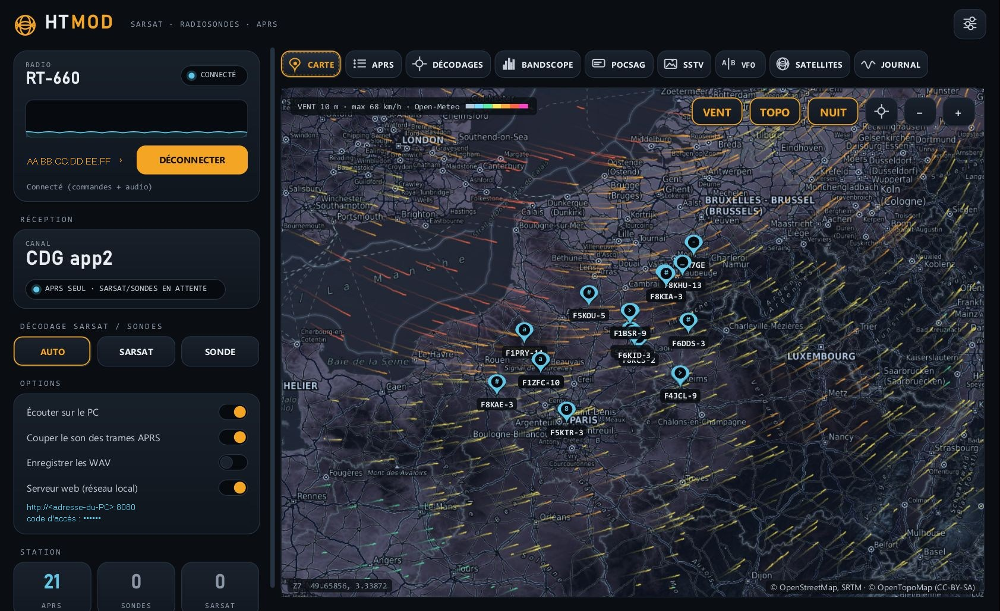

> **Émission radio.** POCSAG et SSTV ne s'émettent que dans les bandes radioamateur (144–146 et 430–440 MHz), après confirmation. Le PTT vocal émet sur le canal du poste, comme son propre bouton PTT. Vous restez responsable du respect de la réglementation et de votre licence.

**Sommaire** : [Installation](#installation) · [Se connecter au poste](#se-connecter-au-poste) · [Fonctions](#fonctions) · [Interface web](#interface-web) · [Compilation](#compilation) · [Organisation du code](#organisation-du-code)

---

## Installation

1. Téléchargez `HTMod-windows.zip` et décompressez-le où vous voulez.
2. Lancez `HTMod\HTMod.exe`. Le runtime Java est inclus, il n'y a rien d'autre à installer.

Configuration requise : Windows 10 ou 11, avec Bluetooth classique.

Les résultats sont enregistrés dans `Documents\HTMod\` : `decodages.csv`, `aprs.txt`, enregistrements WAV, images SSTV, cache des tuiles et des satellites.

## Se connecter au poste

**Avant la première connexion :**
- Appairez le poste une seule fois, dans **Paramètres Windows › Bluetooth et appareils › Ajouter un appareil**. Allumez le poste et laissez son Bluetooth actif.
- **Coupez le Bluetooth du téléphone** (ou fermez l'appli constructeur) : le poste n'accepte qu'une connexion à la fois.

<table>
<tr>
<td width="33%" valign="top">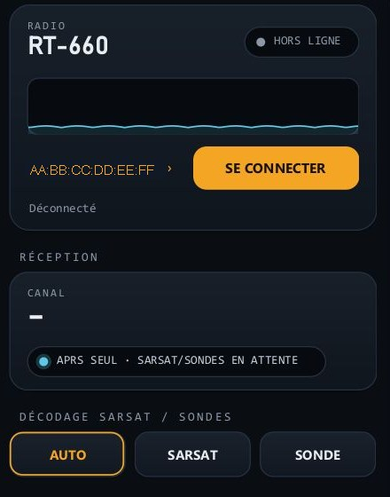</td>
<td width="33%" valign="top">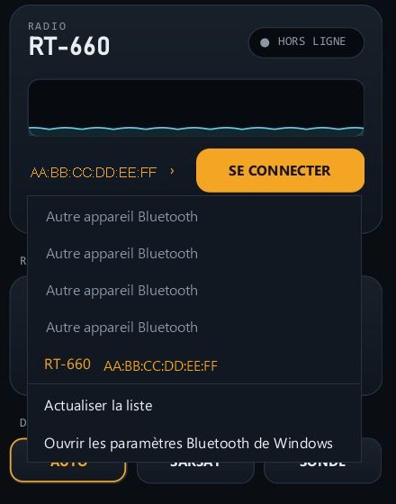</td>
<td width="33%" valign="top">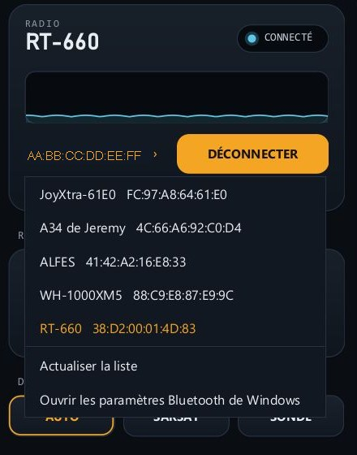</td>
</tr>
<tr>
<td valign="top"><b>1.</b> Dans la carte <b>RADIO</b>, cliquez sur l'adresse du poste, en orange (<code>Poste ›</code> au premier lancement).</td>
<td valign="top"><b>2.</b> Choisissez votre poste parmi les appareils appairés. <i>Actualiser la liste</i> relit les appareils de Windows.</td>
<td valign="top"><b>3.</b> Cliquez sur <b>SE CONNECTER</b>. La pastille passe à <b>CONNECTÉ</b>, et le canal reçu s'affiche dans <b>Réception</b>.</td>
</tr>
</table>

HTMod se souvient du poste choisi. Si la liaison se coupe, il réessaie toutes les 15 s, jusqu'à ce que vous cliquiez sur **DÉCONNECTER**.

**En cas de problème :**
- *Aucun appareil appairé* : refaites l'appairage dans Windows, puis cliquez sur *Actualiser la liste*.
- *La connexion échoue* : vérifiez que le téléphone n'est plus connecté au poste, puis éteignez et rallumez le poste.
- Le **JOURNAL** détaille chaque étape : « connected 0 gaia » pour les commandes, « connected 1 » pour l'audio.

## Fonctions

### Carte
Carte OpenStreetMap avec mode **NUIT**, fond **TOPO** et **VENT** animé (Open-Meteo, 10 m). Elle affiche les stations APRS, balises SARSAT et radiosondes, avec leur trace et une fiche détaillée au clic. Les trames APRS des 24 dernières heures sont rechargées au démarrage.

### APRS
Trames reçues par le TNC du poste et par le démodulateur AFSK 1200 du PC : positions (Mic-E et format compressé compris), objets, messages, télémétrie. Un double-clic montre la station sur la carte.

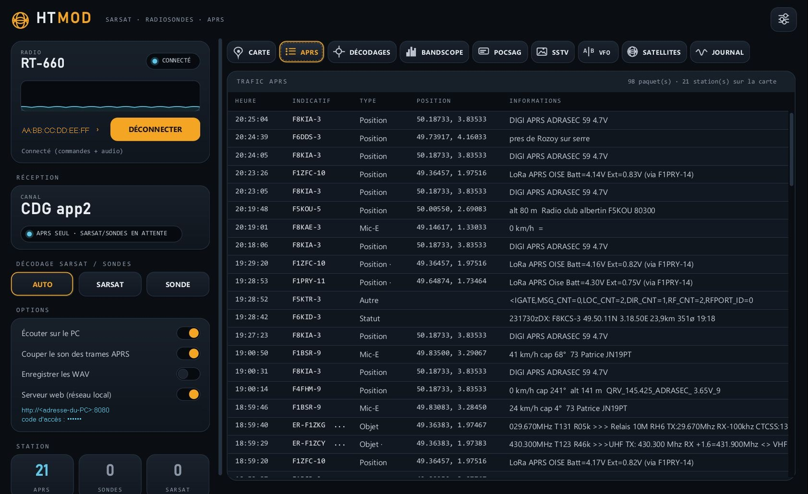

### Décodages SARSAT et radiosondes
Les balises de détresse 406 MHz et les radiosondes (RS41, DFM…) sont décodées quand le canal reçu s'appelle « SARSAT » ou « Radiosonde ». On peut aussi forcer le décodage avec les touches **SARSAT** et **SONDE**. Chaque décodage déclenche une notification Windows, une ligne dans `decodages.csv` et un enregistrement WAV.

### Bandscope
Le poste balaie de ±100 kHz à ±1 MHz autour de la fréquence, avec un pas de 6,25, 8,33, 12,5 ou 25 kHz. HTMod relève le S-mètre à chaque pas et affiche la cascade des balayages. Un double-clic permet d'écouter une fréquence. Rien n'est écrit dans la mémoire du poste.

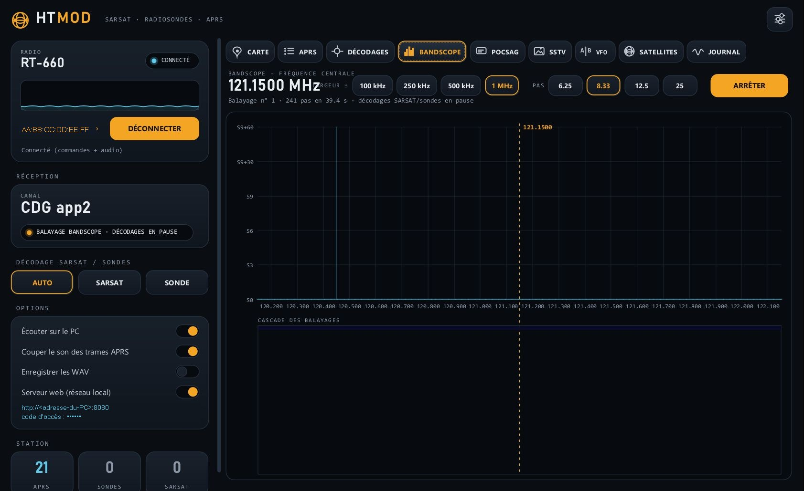

### POCSAG
Réception permanente à 512, 1200 et 2400 bauds avec correction d'erreurs BCH. Émission de messages alphanumériques ou numériques, vers DAPNET par exemple.

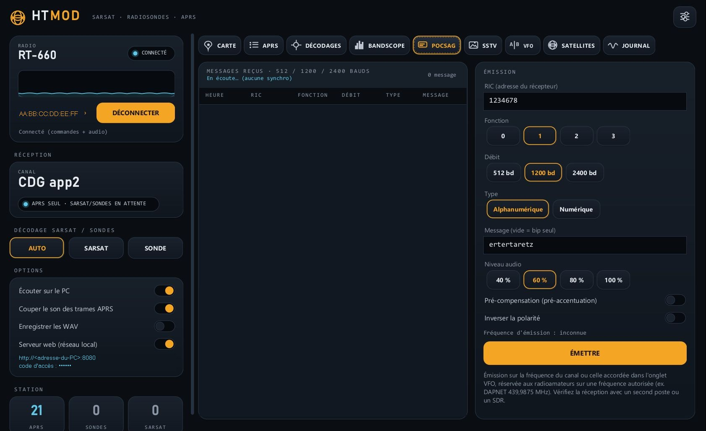

### SSTV
- **Réception** automatique (Robot 36/72, Martin M1/M2, Scottie S1/S2/DX, PD 90 à 240) avec correction de l'inclinaison. Les images sont enregistrées en PNG et rangées dans une galerie.
- **Émission** d'une image de votre choix ou d'une mire de test, avec un texte incrusté (votre indicatif par exemple).

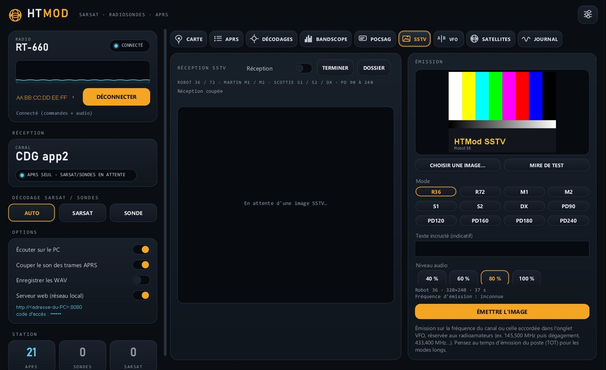

### VFO, poste et canaux
- Double veille : écoute du VFO A et du VFO B.
- Volume et squelch du poste.
- **PTT** maintenu avec le micro du PC.
- Groupes et canaux mémoire, et accord sur une fréquence libre.
- **Clic droit sur un canal** :
  - **Modifier le canal** (nom, fréquences, CTCSS/DCS, puissance, largeur, FM/AM, scan, émission interdite) et l'écrire dans le poste. Les réglages non modifiés sont recopiés à l'octet près.
  - Mettre le canal sur le VFO A ou B.
  - **Exporter le groupe en CSV**, au format HTCommander.

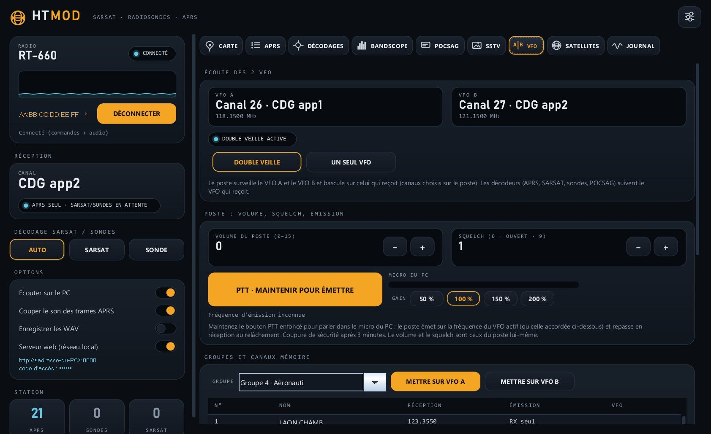

### Satellites
Les satellites viennent de plusieurs sources : le serveur de Benshi, une base FM/SSTV intégrée, les TLE de CelesTrak et vos propres ajouts. L'onglet calcule l'orbite (SGP4/SDP4), les passages sur 24 h, la trace au sol et l'empreinte. On peut filtrer sur la SSTV et sur l'élévation minimale. **SUIVRE AVEC LE POSTE** corrige le Doppler en continu.

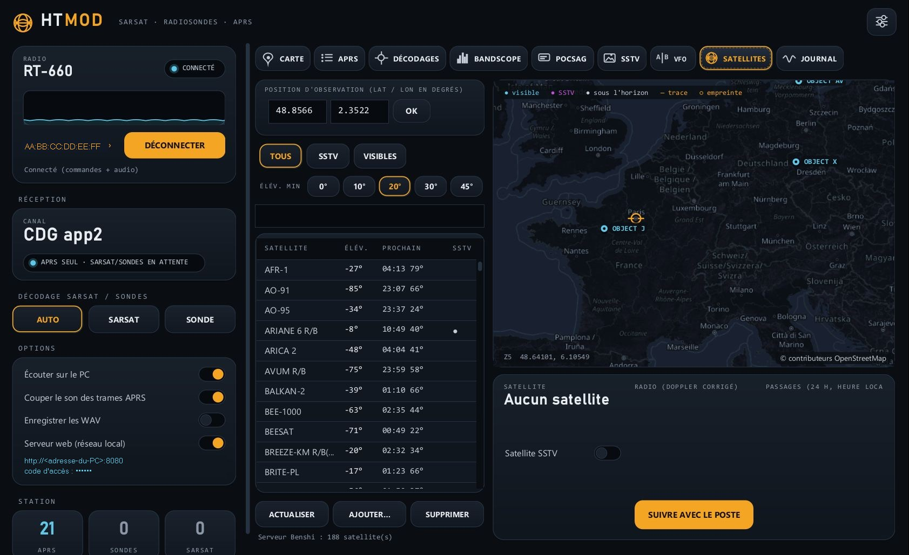

### Journal et options
- **Écouter sur le PC**, avec une option pour couper le son des trames APRS. Les trames restent décodées.
- Enregistrement des WAV.
- Serveur web.

Le **JOURNAL** affiche en direct tout ce qui se passe.

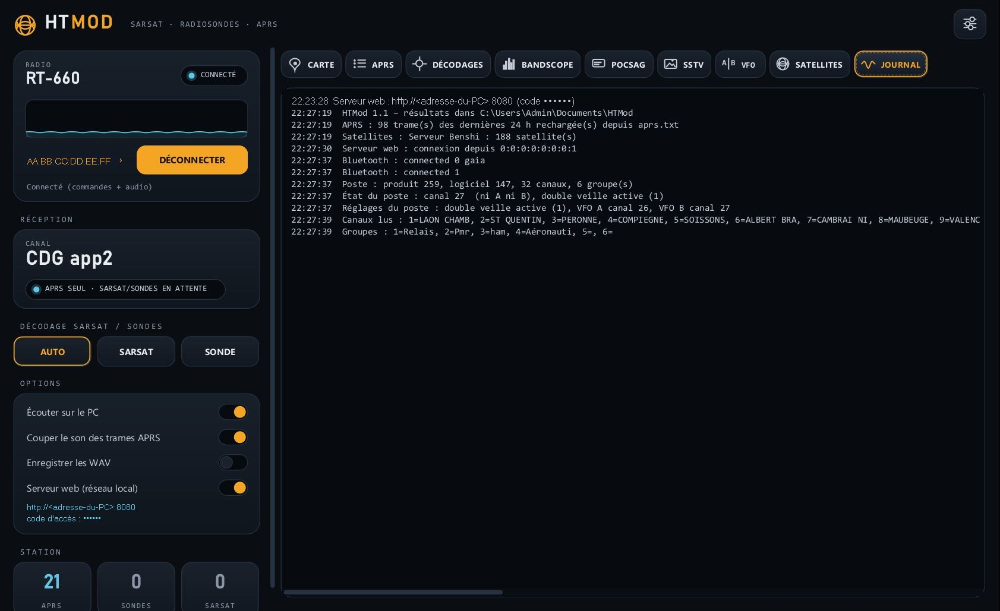

## Interface web

Dans **Options**, l'interrupteur **Serveur web (réseau local)** affiche une adresse (par exemple `http://192.168.1.10:8080`) et un **code d'accès à 6 chiffres**. Ouvrez cette adresse sur un téléphone, une tablette ou un autre PC du même réseau, puis saisissez le code.

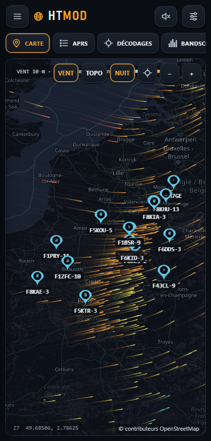

- La page reprend **toute l'application** avec le même design : colonne radio et 9 onglets. Elle est rendue nativement par le navigateur.
- L'état arrive en direct, et chaque action passe par la même fonction que le bouton de l'appli. Le PC et le navigateur restent synchronisés.
- **SON** diffuse dans le navigateur l'audio reçu par le poste. Il faut appuyer à chaque ouverture de la page, car les navigateurs l'exigent.
- Le **PTT** utilise le micro du PC : les navigateurs n'autorisent le micro qu'en HTTPS.
- Si les autres appareils n'arrivent pas à se connecter, cliquez sur **AUTORISER DANS LE PARE-FEU** dans Options. Windows demande confirmation, puis crée une règle avec `netsh`.

<br clear="right">

## Windows Defender

`HTMod.exe` et `btbridge.exe` ne sont pas signés numériquement. Defender peut donc les juger suspects par heuristique (détections en `!ml`). HTMod ne lance aucun script et ne modifie le pare-feu que si vous cliquez sur le bouton prévu. En cas de faux positif, vous pouvez le signaler à Microsoft sur <https://www.microsoft.com/wdsi/filesubmission>.

## Compilation

Prérequis :
- **JDK 17**, avec `javac`, `jar` et `jpackage` ;
- le compilateur C# de **.NET Framework 4**, `csc.exe`, présent sur tout Windows 10/11 ;
- le dossier voisin `mod/src`, qui contient les décodeurs SARSAT, radiosondes et Reed-Solomon partagés avec la version Android ;
- pour les tests, les enregistrements de [HTCommander](https://github.com/Ylianst/HTCommander) (`HTCommander-main/src/test`).

```powershell
powershell -ExecutionPolicy Bypass -File build.ps1          # compile, teste, empaquette
powershell -ExecutionPolicy Bypass -File build.ps1 -NoTest  # sans les tests
```

Les chemins du JDK et des dossiers voisins sont définis en tête de `build.ps1` : adaptez-les à votre machine.

Le résultat se trouve dans `dist\HTMod\HTMod.exe`, ainsi que dans `dist\HTMod-windows.zip`.

Les tests fonctionnent sans poste : SBC, protocole GAIA, APRS/AFSK, POCSAG, SSTV (9 modes, avec bruit et horloge décalée), SGP4 (vérifié sur les vecteurs officiels SGP4-VER), encodage des canaux mémoire.

Pour travailler sur l'interface web sans recompiler, définissez `HTMOD_WEBDIR=res\com\htmod` : les pages sont alors relues sur le disque à chaque requête.

## Organisation du code

```
bridge/BtBridge.cs      pont Bluetooth (RFCOMM SPP et canal audio « BS AOC », BLE en secours) ; règle de pare-feu à la demande
src/com/htmod/
  App.java              fenêtre principale, colonne radio, onglets, liaison avec le serveur web
  Radio.java            protocole GAIA : réglages, canaux (lecture et écriture), groupes, VFO, état, volume, squelch, audio
  Sbc*.java             codec audio SBC (32 kHz) ; Transmitter.java : émission audio et PTT
  Aprs.java, Ax25.java, Afsk1200.java, AprsMute.java
  Pocsag.java, Sstv.java, Decoders.java (SARSAT, radiosondes)
  Bandscope.java, VfoPanel.java, PocsagPanel.java, SstvPanel.java, SatPanel.java
  Sgp4.java, SatTrack.java, SatCatalog.java   orbites, passages, catalogues de satellites
  MapPanel.java, WindLayer.java               carte à tuiles et vent animé
  WebServer.java, Json.java, Firewall.java    serveur web local (API JSON, SSE, tuiles, audio)
  Shack.java            habillage « shack de nuit » (touches en relief, puits, pastilles)
res/com/htmod/web/      interface web (index.html, app.css, map.js, views.js, app.js)
test/                   tests sans poste (WinTest)
docs/                   captures d'écran du README
```

## Remerciements

- [HTCommander](https://github.com/Ylianst/HTCommander) (Ylian Saint-Hilaire) : documentation du protocole Benshi, du codec SBC et du format CSV des canaux.
- Habillage repris de l'application *Radtel Tools*.
- Calcul d'orbite d'après le SGP4 de David Vallado (*Revisiting Spacetrack Report #3*).
- Données et services : © contributeurs OpenStreetMap, OpenTopoMap, Open-Meteo, CelesTrak, SatNOGS, serveur satellites Benshi.

## Licence

À préciser par l'auteur avant publication. Ajoutez un fichier `LICENSE`, par exemple MIT ou GPL-3.0.
